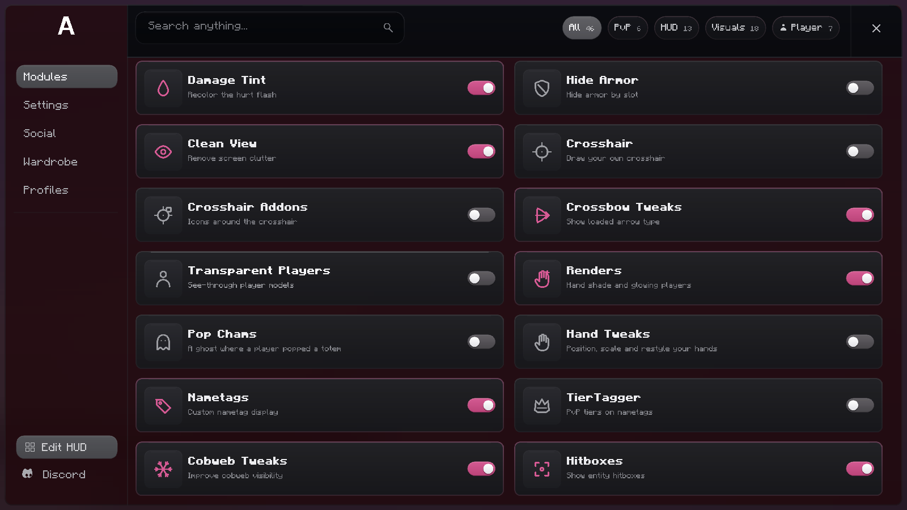

# CrossMod

CrossMod is an all in one PvP client for Minecraft. The current build is the
visual shell: a full-window sheet of smoked glass with a hot pink accent, a
labeled sidebar, a search and filter header and two columns of module cards.

The project is a client only Fabric mod for **Minecraft 26.3**.



*The shell fills the window with a narrow outer margin. The world behind it is
captured, blurred and pushed towards a dark magenta, independently of the
vanilla menu blur setting. The HUD is hidden while the shell is open.*

---

## Features

* **A full-window glass shell** - a rounded panel sits four GUI units from every
  window edge. Every surface is drawn from anti-aliased four-times textures, so
  the corners stay smooth at any GUI scale.
* **A captured, heavily blurred backdrop** - the last world frame is downscaled,
  box-blurred and drawn as an opaque first layer. A dark magenta scrim is applied
  on top, so the glass stays readable and never depends on the user's
  *Menu Background Blurriness* setting.
* **Two proportional card columns** - 46 preview cards show the density, the
  hierarchy and the styling of the finished list. The grid scrolls inside the
  panel.
* **A labeled sidebar** - Modules, Settings, Social, Wardrobe and Profiles, with
  Edit HUD and the Discord link pinned to the bottom.
* **A search and filter header** - search by name, then narrow the list with the
  All, PvP, HUD, Visuals and Player filters, each with its own count.
* **Clear card states** - the icon, border and toggle turn hot pink when a card
  is on and stay gray when it is off. The previews can be clicked and toggled
  without touching the module registry.
* **Configurable key bindings** - **Right Shift** opens and closes the shell by
  default. It is registered with Minecraft and can be changed in the controls
  screen.

The module registry ships empty on purpose. The cards in the shell are previews:
they demonstrate the density and the styling of the interface but are not backed
by real modules yet. Features are added one at a time and can then be bound to
the card list.

## Requirements

| | |
|---|---|
| Minecraft | 26.3 |
| Fabric Loader | 0.19.3 or newer (tested up to 0.20.1) |
| Fabric API | 0.164.0+26.3 |
| Java | 25 |

## Building

The project uses the Gradle wrapper that ships with the repository, so no local
Gradle installation is needed.

```bash
./gradlew build
```

The finished mod is written to `build/libs/`.

To start a development client:

```bash
./gradlew runClient
```

> **Note**
> Minecraft 26.3 and Fabric Loom require a Java 25 runtime. The Gradle daemon
> itself has to run on Java 25 as well. The `settings.gradle` file registers the
> Foojay toolchain resolver, so a matching JDK is downloaded automatically when
> one is missing.

## Project layout

```
src/main/java/io/github/crossmod
├── CrossMod.java                  Common entry point and configuration store
└── config/ConfigManager.java      JSON backed configuration

src/client/java/io/github/crossmod/client
├── CrossModClient.java            Client entry point, wiring of all services
├── keybind/KeyBinds.java          Key bindings of the mod
├── module/                        The module framework
│   ├── Module.java                Base class of every module
│   ├── ModuleCategory.java        Categories used by the module framework
│   └── ModuleManager.java         Registry, life cycle and persistence
├── setting/                       The settings of the modules
├── discord/                       The link between the game and the Discord server
│   ├── DiscordLinkClient.java     Talks to the bot of the server
│   └── DiscordChatCommands.java   The .link command of the chat
├── gui/                           The interface
│   ├── screen/                    The full-window shell and the placeholder pages
│   ├── render/                    Drawing helpers and the captured menu backdrop
│   └── theme/                     Colours, metrics and user settings

bot/                              The Discord bot of the server (C# / .NET 8)
```

### Adding a module

1. Create the module in `module/impl/<category>/` and extend `Module`.
2. Register it in `ModuleManager#registerBuiltIns`.

```java
public final class ExampleModule extends Module {

    private final BooleanSetting enabled = addSetting(new BooleanSetting(
            "enabled", "Enabled", "Turns the example on", true));

    public ExampleModule() {
        super("example", "Example", "An example module", ModuleCategory.UTIL);
    }

    @Override
    public void onTick() {
        // Runs every client tick while the module is active.
    }
}
```

The module is stored in `config/crossmod.json`. The current shell still renders
its fixed preview list; binding real modules to the cards is the next step once
the visual set has been pruned.

## The Discord bot

The server has its own bot, it lives in [`bot/`](bot/README.md) and is written
in C# on .NET 8. It welcomes new members, counts them, hands out roles on
reactions and links a Discord account to a Minecraft account.

The mod and the bot talk to each other over a small HTTP interface. A player
runs `/link` in Discord, types `.link <code>` in the chat of the game and the
bot grants the verified role.

The address of the bot and the shared secret are read from the configuration
file of the mod, `config/crossmod.json`:

```json
{
  "discord": {
    "api_url": "http://localhost:8080",
    "api_key": "a-long-random-string"
  }
}
```

While the bot runs on the same machine, `http://localhost:8080` is the
address. A public address comes with the deployment, see
[`bot/README.md`](bot/README.md).

## The interface

### Layout

```
┌──────────────────────────────────────────────────────────────┐
│  A   │  Search anything...        [All] [PvP] [HUD] ...  [X] │
│      ├─────────────────────────┬────────────────────────────┤
│ Mod  │ Damage Tint        (on) │ Hide Armor           (off) │
│ ...  │ Recolor the hurt flash  │ Hide armor by slot         │
│      │                         │                            │
│ ...  │ Clean View         (on) │ Crosshair            (off) │
│      │ Remove screen clutter   │ Draw your own crosshair    │
│      │                         │                            │
│ Edit │ ...                     │ ...                        │
│Discord                                                       │
└──────────────────────────────────────────────────────────────┘
```

* The panel has a fixed 108 unit sidebar, a 47 unit header and a two-column
  content area. The two columns share the remaining width equally, with an
  8 unit gutter between them.
* The header holds the search field on the left, the filter pills on the right
  and a separate close cell at the far right. The close cell is split from the
  filters by a one pixel divider.
* Every card is 49 units high with a 34 unit icon tile. Clicking a card toggles
  its preview state; clicking a filter or typing in the search field rebuilds
  the visible list.
* The sidebar pages are placeholders in this shell. Only the Modules page is
  fully populated; the other pages keep the same frame and title.
* The grid scrolls with the mouse wheel when there are more cards than fit.

### The backdrop

A CrossMod screen does not draw the opaque vanilla menu background. Instead it:

1. captures the current world frame when the screen opens,
2. downscales it to 160 pixels wide and box-blurs it twice,
3. draws the blurred texture opaquely over the whole viewport, so no earlier
   frame or UI can accumulate behind the glass,
4. applies a forced dark magenta scrim, independent of the vanilla blur option,
   and
5. draws the panel, header, cards and text on top.

The HUD is hidden while the shell is open. The captured frame is refreshed every
time the shell is opened, so it always reflects the current world.

### Assets

All surfaces and icons are generated procedurally, so every corner and every
glyph can be reviewed and reproduced:

```bash
javac -d tools/asset-gen/out tools/asset-gen/GuiSkinGenerator.java
java -cp tools/asset-gen/out tools.GuiSkinGenerator src/main/resources/assets/crossmod/textures/gui

javac -d tools/asset-gen/out tools/asset-gen/IconGenerator.java
java -cp tools/asset-gen/out tools.IconGenerator src/main/resources/assets/crossmod/textures/gui
```

The generators write four-times resolution textures; the game scales them down
with linear filtering. The generated files live in
`src/main/resources/assets/crossmod/textures/gui`.

### Developer hooks

The interface can be verified without a human at the keyboard. The following
environment variables are read by the client and are inert otherwise:

| Variable | Effect |
|---|---|
| `CROSSMOD_DEV_OPEN_GUI` | Opens the interface after the given amount of ticks. |
| `CROSSMOD_DEV_OPEN_MODULE_SETTINGS` | Opens the settings of the first module. |
| `CROSSMOD_DEV_OPEN_GUI_SETTINGS` | Opens the settings of the interface. |
| `CROSSMOD_DEV_SCREENSHOT` | Takes a screenshot of the game into `run/screenshots`. |

```bash
CROSSMOD_DEV_OPEN_GUI=90 CROSSMOD_DEV_SCREENSHOT=1 ./gradlew runClient
```

For automated screenshots the client also stages the developer world: it sets
the time to day, clears the weather and moves the player high above the world in
spectator mode, so the captured backdrop has a bright sky instead of a cave.

## Links

* Discord: https://discord.gg/tDe4cZYyuV
